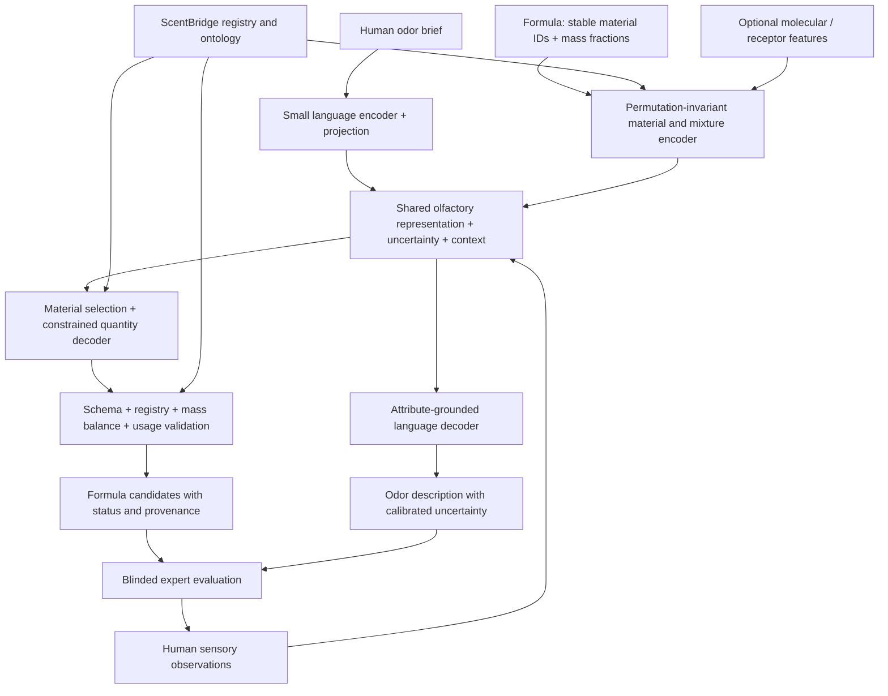

# Proposed architecture and training pipeline

## Representation first

ScentBridge 1.0 is a versioned knowledge layer: materials, molecule links, an odor ontology, measured observations, source provenance, constraints and embedding artifacts. It is not a vector database of language descriptions alone.

Maintain a shared perceptual representation `z = (a, r, u, c)`: named attribute estimates `a`, a learned residual vector `r`, uncertainty/missingness `u`, and measurement context `c`. Start with 16–32 curated perceptual attributes and a 64-dimensional residual only after a linear baseline. Those are tunable design choices, not established dimensions of smell. Do not normalize away intensity. Context contains concentration, carrier, temperature, substrate and elapsed time; unknown values remain unknown.

E0 uses only a complete observed attribute vector as `z`. It has no residual, dynamics or neural language model. Later stages must demonstrate that the additional representation predicts held-out human observations.

## Component diagram



This is the target design; diagram arrows do not represent already implemented services.

## Formula and mixture path

Represent a material as a stable registry ID with supplier/grade/version, not just a molecule or CAS number. Naturals and bases may have multiple or unknown constituents. A molecular embedding is an optional feature, accompanied by a missingness mask; it cannot identify every commercial material.

Encode each ingredient as `(material embedding, log concentration, dilution, context)`. Compare weighted pooling to DeepSets or a small set-attention network. Include a pairwise residual only if paired observations improve a group-held-out benchmark. Do not assume weighted molecular embeddings approximate mixture perception linearly.

Formula generation is one-to-many. Retrieve a permitted candidate palette, choose a bounded set without repetition, then predict amounts conditional on `z` and context. Start with at most 16 ingredients from a 100–500-material pilot registry. Use integer mass parts per million, sum exactly 1,000,000. Translate to grams only when a batch size is supplied. A stock solution and a neat material are distinct registry entries.

The decoder must include carrier material explicitly when present. Known-stock constituent mass is `stock fraction × constituent fraction`; apply usage limits on the appropriate finished-product basis. Do not silently renormalize an invalid output or invent a replacement material. Return a structured failure with the violated constraint or missing information, then allow one bounded regeneration.

For a learned decoder, combine a set-presence objective with a composition distribution conditional on selected materials. Canonical serialization by ID is for transport, not a claim that formula order is meaningful. Optimize expected perceptual quality over multiple feasible candidates rather than requiring one exact recipe.

## Language path

Use a compact existing model as a benchmark and text front end. Project text hidden states into `z`; condition the reverse decoder through a small learned prefix/cross-attention adapter. A structured attribute rendering is the fallback before a trained language decoder exists. Attribute contradictions, negation and uncertainty need explicit evaluation, including Swedish/English briefs if both are offered.

Database facts are retrieved by ID. Names, synonyms, supplier identifiers, safety sources and molecular properties are not memorization targets. Human descriptions remain observations rather than the latent coordinate system.

## Training stages

```text
Rights-cleared source snapshots
  → immutable raw records and checksums
  → identity resolution, units, ontology mappings and duplicate families
  → split assignment BEFORE augmentation
  → private locked test manifest / working train+validation
  → E0 shared attribute-space baseline
  → independent bidirectional small-LM benchmark
  → shared representation training with masked supervision
  → constrained formula and grounded language heads
  → expert preference refinement
  → distillation and measured architecture/compute ablations
  → quantization and local runtime validation
```

For paired data, use attribute regression/classification, contextual sensory similarity and contrastive alignment. Contrastive negatives must exclude duplicates and known perceptual equivalents. For formulas, add set-presence and quantity losses where valid. For unpaired descriptions use language/attribute tasks; for unpaired formulas use denoising/set tasks; for molecular records use odor-label supervision only at their evidential level.

A candidate objective is:

`L = λa L_attributes + λc L_alignment + λf L_formula + λt L_text + λcycle L_perceptual_cycle + λu L_uncertainty`.

Normalize by available labels and tune weights on validation only. Missing labels are masked, not zero. Estimate uncertainty from held-out calibration and ensemble/distributional heads; language-model confidence alone is insufficient.

Cycle consistency compares predicted perceptual attributes or an independently validated perceptual metric. Do not rely exclusively on a jointly trained encoder/decoder that can collude or collapse. Anchor latent space to human ratings, inspect variance/collapse and compare shuffled-pair and constant-vector controls. Reconstructed formulas need perceptual equivalence, not identical ingredients.

Back-translation is generated only from training records, passes structural checks, retains teacher lineage and remains synthetic. Teachers can normalize, explain or label errors; they cannot certify an unmeasured mixture. Cap synthetic examples at an initial 25% of training sampling and ablate that cap. This is a starting policy; choose final weighting from real validation data. Expert human evidence outranks conflicting synthetic labels, while preserving genuine differences between assessors and conditions.

## Preference learning

Store blinded A/B ordering, chosen/tied/neither, expert pseudonym, confidence, rationale, sensory context, corrected attributes, substitutions and feasibility judgments. Separate on-screen feasibility judgments from actual smelling. DPO fits paired preferences on sequences; for non-sequence formula candidates a pairwise ranking head is simpler. Use KTO only if data are independent desirable/undesirable judgments. GRPO waits for a reward proven to track sensory outcomes.

## Sparse and dynamic architecture research

First compare 100–300M dense specialists to 0.6B and larger baselines. Then sweep MoE configurations toward the brief's 2–5B total/300–800M active region, including attention and embeddings in parameter accounting. Use top-1 versus top-2 routing, capacity limits, load balancing, token-drop accounting and expert utilization reporting. Expert identities are discovered/validated, not assigned attractive names and assumed useful.

Add specialist heads for temporal development, intensity or interactions before creating separate expert language models. Router choices can skip molecular extraction when cached and skip generation for exact catalog retrieval. Dynamic depth is a later independent ablation, with explicit KV and recurrent-state semantics and full-depth fallback for out-of-distribution cases.

Evaluate hybrid attention/state-space, PLE/n-gram lookup, MTP and speculative decoding separately. They change cache/state/storage requirements. A consumer deployment path and numerical reference implementation are prerequisites for accepting a custom architecture.
